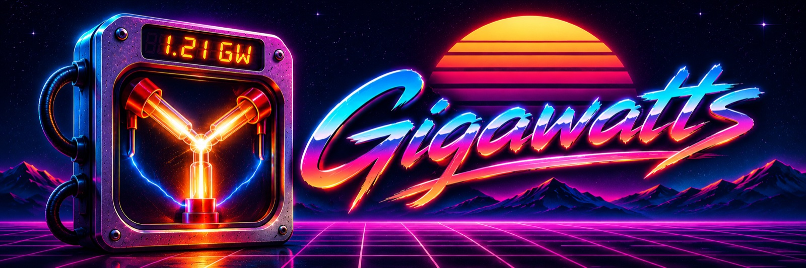
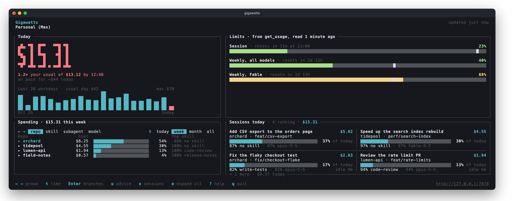
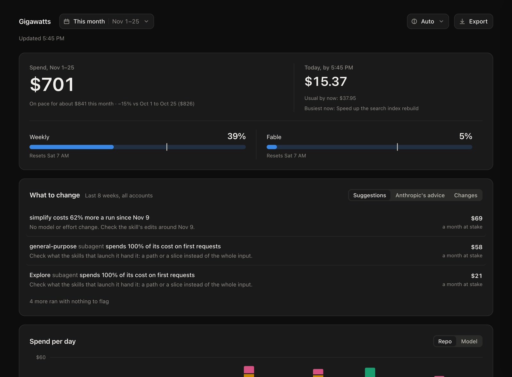

<p align="center"></p>

# Gigawatts

A local usage monitor for Claude Code. It shows how much of your usage limits you've used, what your work cost, and where it went: by repo, branch, skill, subagent, and model.

It spends no Claude tokens, changes nothing in Claude Code's settings, and never reads your login token. Your numbers stay on your machine.

Gigawatts is in beta. Expect rough edges, and please report what breaks.



## Requirements

- macOS or Linux.
- [Claude Code](https://code.claude.com), installed and logged in, with `claude` on your `PATH`. Gigawatts asks it for fresh limits.
- Rust, to build from source. The repo installs it with [mise](https://mise.jdx.dev), or use [rustup](https://rustup.rs).

## Install

```sh
git clone https://github.com/mikereinmiller/gigawatts.git
cd gigawatts
mise trust          # lets mise use this repo's mise.toml
mise install        # installs the pinned Rust version
mise run install    # builds, installs, and starts the engine
```

That puts `gigawatts` in `~/.cargo/bin`. Make sure that folder is on your `PATH`, ahead of mise's shims: mise also adds a `gigawatts` shim, which fails outside this repo with `No version is set for shim` unless you set a global Rust with `mise use -g rust`. Without mise, run `cargo install --path . --locked`, then `gigawatts stop` and `gigawatts engine`.

The engine keeps running after you close the terminal view, but it stops when the computer restarts. To have it start again at login, run:

```sh
gigawatts service install
```

On macOS this adds a launchd agent; on Linux, a systemd user unit. Without it, opening `gigawatts` starts the engine again, and it catches up on any transcripts Claude Code still has. There are no limit readings for the time it was stopped.

## Use it

Run `gigawatts` to open the terminal view. It shows:

- each limit, with your pace and a countdown to its reset
- today's spend next to a usual day
- every session that spent money today, running ones first
- a spending table you can switch between repo, skill, subagent, and model

Press `?` to see every key.

A light red badge at the right end of the title row means a limit is forecast to fill before it resets and within the next 24 hours, or is already full.

| Command | Does |
|---|---|
| `gigawatts` | Opens the terminal view, starting the engine if needed |
| `gigawatts status` | Prints one line: the closest limit and today's spend. `--all` prints one line per account, `--json` everything as JSON |
| `gigawatts report` | Opens the report page in your browser, at `http://127.0.0.1:7878` |
| `gigawatts data` | Prints cost history. `--range week`, `--by repo`, `--json` for scripts and agents |
| `gigawatts insights` | Prints what each skill and subagent costs per run, week by week, and each shift in it. `--json` for scripts and agents. `--help` includes the steps an agent follows to propose edits |
| `gigawatts schema` | Prints the JSON Schema, with a description of every field, for `status --json`, `data --json`, `data --limits --json`, and `insights --json` |
| `gigawatts accounts` | Lists the Claude Code accounts Gigawatts found and whether each is tracked |
| `gigawatts doctor` | Lists anything wrong, with its cause and fix |
| `gigawatts stop` | Stops the engine |

Every command takes `--help`.

`gigawatts report` opens the same numbers as a page in your browser, with spend per day, limits over time, and where the money went:



## Ask an agent about your spend

Gigawatts does the math; an agent can do the interpreting. Any agent that can run commands can answer questions from `gigawatts data --json`, and `gigawatts schema` tells it what each field means. Try asking:

- "Run `gigawatts data --range week --by skill --json` and tell me which skill cost the most this week and why."
- "Compare this month's spend by repo with last month's using `gigawatts data`, and point out anything that jumped."
- "Use `gigawatts data --range month --by repo --drill <repo> --json` to tell me which branches in this repo were the most expensive."
- "My old plan billed usage at API prices against a $2,000 monthly credit budget. Use `gigawatts data --json` to tell me how far past that budget this month's usage would have gone."

### Find which skills and agents to make cheaper

Ask in any Claude Code session, in any folder:

> Use Gigawatts to show which of my skills and agents cost the most, and what I could change.

Claude runs `gigawatts insights`, reads `gigawatts insights --help` for how to judge the numbers, opens your skill and agent files, and proposes specific edits, each with the file and line, the cost it would save, and what it might cost in quality. It changes nothing until you say which edits to apply. Ask again two weeks after a change to see whether it worked.

The instructions Claude follows ship inside `gigawatts`, so updating Gigawatts updates them. There's nothing to copy or install.

## Build on it

[`docs/integrations.md`](docs/integrations.md) explains the JSON commands, what each field means, and how to show alerts, for anyone building a pane, a status bar, or a script on Gigawatts' numbers. Point an agent at it.

## Accounts

Gigawatts tracks every Claude Code config directory it finds: `~/.claude`, plus any folder in your home directory that looks like one (for example one you use with `CLAUDE_CONFIG_DIR`). Each account's history is kept separately.

- `gigawatts accounts add <path>` tracks a folder somewhere else.
- `gigawatts accounts track <account> off` stops tracking an account and keeps its history.
- `gigawatts accounts forget <account>` deletes an account's history.

## Settings

Settings live in `~/.config/gigawatts/config.toml`. You don't need one to start. The keys an account section takes come from `gigawatts accounts`, which prints each account's ID.

```toml
# Keep per-request detail for 90 days; daily totals are kept forever either way.
request_detail_days = 90

# Serve the report page on another port, or 0 to turn it off.
report_port = 7878

# Download Anthropic's pricing page when a price looks out of date; false never does.
price_updates = true

# Flag a session as spending fast from this many dollars an hour.
fast_usd_per_hour = 20

[accounts."<account id>"]
label = "work"
tracking = true
store_titles = true                        # session titles in history
credit_reset = 2026-11-01T00:00:00Z        # when monthly credits reset, if not midnight UTC on the 1st
```

## What it stores, and where

History lives in `~/.local/share/gigawatts/history.sqlite3`, readable only by you. It holds counts, costs, models, repos, branches, times, session titles, and each account's email and IDs. It never stores prompts, responses, tool inputs, file contents, or commands, and Gigawatts sends none of it anywhere. Its one network request downloads Anthropic's public pricing page, at most once a day and only when a price looks out of date; `price_updates = false` turns it off.

The report page listens on `127.0.0.1` only, but any user account on the same computer can reach it. On a shared machine, set `report_port = 0`.

## Update

```sh
cd gigawatts
git pull
mise run install
```

`mise run install` stops the running engine and starts the new one. Check what you're running with `gigawatts --version`.

## Uninstall

```sh
gigawatts service uninstall
gigawatts stop
cargo uninstall gigawatts
rm -rf ~/.local/share/gigawatts ~/.config/gigawatts   # deletes your history and settings
```

## How it works

[`docs/overview.md`](docs/overview.md) is the full design: where each number comes from and how costs are priced.

## Contributing

Bug reports and feature requests are welcome as issues. Pull requests come from collaborators only. See [`CONTRIBUTING.md`](CONTRIBUTING.md).

## License

MIT. See [`LICENSE`](LICENSE).
